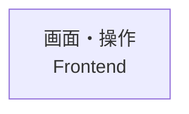

# 作業記録の形式 / Project Records

### タスク管理ファイルの基本形式

`tasks/todo.md` には以下を書くこと。

```markdown
## 運用ルール
1. タスクを追加するときはチェックボックス形式で書く
2. 完了したら [x] にする
3. セクションが全て完了したら、セクションごと削除してよい
```

`tasks/lessons.md` には以下を書くこと。

```markdown
# Lessons - 過去の失敗と学び

## INDEX（追記・修正のたびに必ず更新すること）
| カテゴリ     | 説明                          | 開始行 | 件数 |
|--------------|-------------------------------|--------|------|
| meta         | AIとの協働ルール              | -      | 0    |
| boundary     | データ型・変換・境界契約      | -      | 0    |
| architecture | 設計・責務・config            | -      | 0    |
| quality      | テスト・CI/CD・品質保証       | -      | 0    |
| ui           | フロントエンド・デザイン・VRM | -      | 0    |

---

## meta — AIとの協働ルール
### [タイトル（キーワードを含む1行）]
- **症状**:
- **原因**:
- **対策**:

## boundary — データ型・変換・境界契約
### [サブカテゴリ: タイトル]

## architecture — 設計・責務・config
### [サブカテゴリ: タイトル]

## quality — テスト・CI/CD・品質保証
### [サブカテゴリ: タイトル]

## ui — フロントエンド・デザイン・VRM
### [サブカテゴリ: タイトル]
```

`tasks/alignment.md` には以下を書くこと。これは `tasks/lessons.md` とは別軸で管理する。

- `alignment.md`: 現在のプロジェクト構造、対象の指し方、概念と実装の対応、現在有効な共有認識
- `lessons.md`: 過去に起きた失敗、その原因、再発防止策

`alignment.md` の中心は単なる用語集ではなく、人間とAIが同じ対象を指せるようにする **Project Tree（プロジェクト構造図）** とする。

````markdown
# Alignment - 共有構造と意味の対応 / Shared Structure and Semantics

このファイルは、人間とAIが作っているものの構造を同じ視点で捉え、
要望が「何の、どの側面を、どう変えたいのか」を特定するための共有地図である。

---

## 全体地図 / Project Overview

```text
プロジェクト / Project
├─ 画面・操作 / Frontend
├─ 処理・データ / Backend
└─ 実行環境 / Infrastructure
```

## 領域地図 / Domain Maps

### 画面・操作 / Frontend



### 処理・データ / Backend

### 実行環境 / Infrastructure

## 構造と実装の対応 / Structure-to-Implementation Mapping

### [日本語名 / English Name]
- **役割 / Responsibility**:
- **親 / Parent**:
- **含むもの / Contains**:
- **画面上の位置・利用者からの見え方 / Human View**:
- **実装 / Implementation**:
  - Components:
  - Files:
  - State:
  - API:
- **指示に使える表現 / Human Labels**:
- **曖昧になりやすい表現 / Ambiguous Labels**:

## 用語・概念 / Terms and Concepts

### [日本語 / English]
- **意味 / Meaning**:
- **別名 / Aliases**:
- **NG解釈 / Wrong Interpretation**:
- **OK解釈 / Correct Interpretation**:

---

## 意味の衝突記録 / Semantic Conflict Log

### YYYY-MM-DD「[ユーザーの言葉]」
- **対象候補 / Candidate Target**:
- **ユーザーの意図 / User Meaning**:
- **AIの解釈 / Agent Interpretation**:
- **実装上の実体 / Actual Implementation**:
- **現在の解釈規則 / Current Rule**:
- **状態 / Status**: unresolved / resolved

## 未解決の観察 / Unresolved Observations

### YYYY-MM-DD「[まだ分類できない要望・違和感]」
- **観察 / Observation**:
- **対象候補 / Possible Targets**:
- **概念候補 / Possible Concepts**:
- **確信度 / Confidence**: low / medium / high
- **次に確認すること / Next Question**:
````

### Alignmentの作成・保守規則

1. 表示名は原則として `日本語名 / English Name` の順で併記する。
2. 最初に全体地図を置き、Frontend、Backend、Infrastructureなどの領域へ段階的に降りられる構造にする。
3. Project Treeはコードのディレクトリ構造ではなく、人間が機能や画面を指せる安定した構造として書く。
4. ファイル、Component、State、APIなど変化しやすい情報は、Project Treeと分離してImplementation Mappingに記録する。
5. 人間向けの地図には実装情報を詰め込みすぎず、全体地図 → 領域地図 → 詳細の順に段階表示する。
6. Mermaidを表示できる環境では領域地図を図示し、表示できない環境でも理解できるテキスト木構造を併記する。
7. 木のノードは、人間が修正対象として指したくなるもの、独立した役割を持つもの、要望や制約が付くものを中心にする。個々のCSSプロパティや関数まで無制限に展開しない。
8. 要望を受けたAIは、可能な限り `対象ノード / Target`、`側面 / Aspect`、`期待する変化 / Expected Change` を示して解釈を確認する。
9. 対象を一意にできない場合、AIは勝手に決定せず、Project Tree上の候補を人間に分かる表現で示す。
10. 機能の追加・削除・名称変更・責務変更時はProject Treeを更新し、実装ファイルの移動・Component分割・API変更時はImplementation Mappingを更新する。
11. 人間が使った新しい呼び方はHuman Labelsへ追加し、意味を取り違えた場合はSemantic Conflict Logへ記録する。
12. まだ何を指すか確定できない要望は、無理に分類せずUnresolved Observationsへ保持する。
13. Semantic Conflict LogとUnresolved Observationsは、Project TreeとImplementation Mappingを修復・成長させる補助軸として扱う。
14. 過去の失敗・原因・再発防止策は `lessons.md` に記録し、現在有効な構造や意味を示す `alignment.md` と混在させない。

**更新タイミング：**
- 機能や責務が変わったとき → Project Treeを更新
- 実装位置や方式が変わったとき → Implementation Mappingを更新
- 新しい呼び方が判明したとき → Human LabelsまたはTermsへ追加
- 認識のずれが発生したとき → Semantic Conflict Logへ追記し、必要なら地図・対応関係も修正
- まだ分類できない要望が出たとき → Unresolved Observationsへ追記
- 誤解の原因と再発防止策が得られたとき → `lessons.md`へ記録
